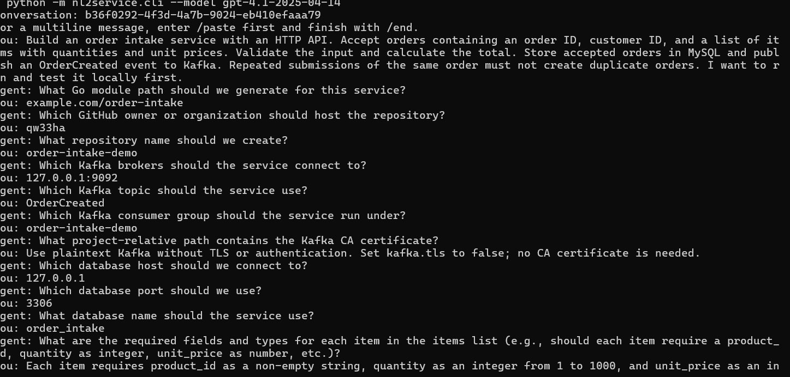
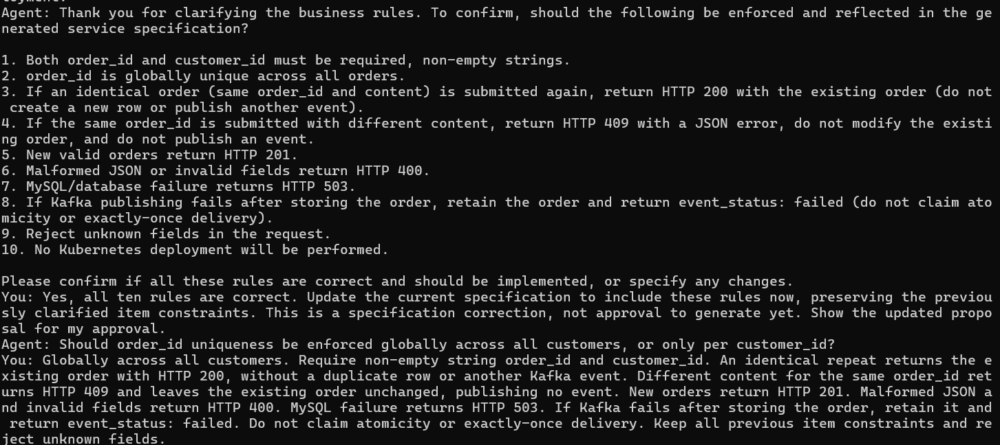
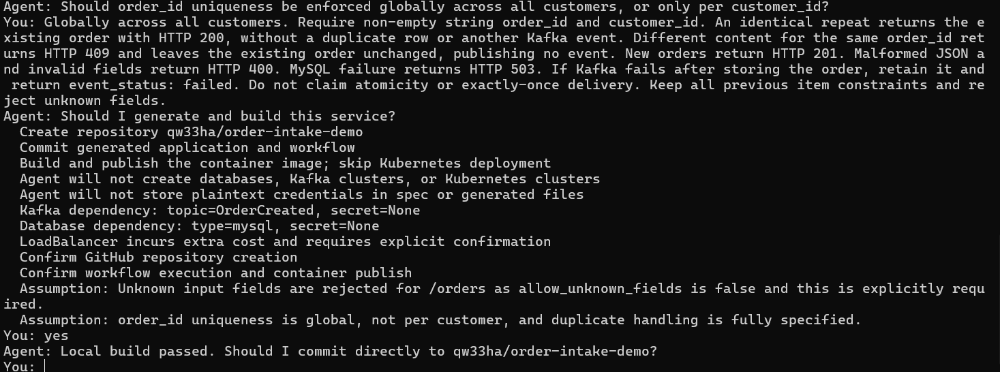

# NL2Service

**A conversational agent that turns backend requirements into build-verified Go services.**

Describe a service, answer the Agent's questions, and review the generated project.
NL2Service uses LangGraph to manage the conversation, retrieves implementation references,
and feeds local build and CI diagnostics into a bounded repair loop. Generated services use
[tRPC-Go](https://github.com/trpc-group/trpc-go), with optional GitHub Actions delivery.

[Quick demo](#quick-demo) · [Architecture](#how-it-works) · [Quick start](#quick-start) · [Evaluation](#evaluation-highlights)

## Quick demo

This session asks for an HTTP order intake service backed by MySQL and Kafka.
The Agent clarifies configuration, item validation and duplicate-order handling,
then generates and locally builds a new Go project.

**1. Describe the service and fill in missing configuration.**



**2. Clarify business rules before generation.**

The conversation specifies integer-cent pricing, globally unique order IDs,
HTTP 409 for conflicting retries, and explicit Kafka failure handling.



**3. Approve generation and reach a verified local build.**



These are unedited screenshots of the live CLI session; responses were entered by
an assistant through process stdin. This session reached local build success after
compiler feedback and repair, and stops at the separate GitHub delivery gate.
It does not demonstrate runtime correctness or remote delivery of this order service.

**CI/CD Actions:** [simpleService](https://github.com/qw33ha/simpleService) ·
[GitHub Actions runs](https://github.com/qw33ha/simpleService/actions)

## How it works

| Component | What it contributes |
|---|---|
| Stateful orchestration | LangGraph interrupts for questions and approvals; SQLite checkpoints for resuming conversations. |
| Typed requirements | Pydantic specifications plus conversation context for business rules and later corrections. |
| IR-aware RAG | BM25 and dense retrieval, reciprocal rank fusion, compatibility reranking and capability/dependency closure. |
| Generation | Agent-authored business logic with deterministic scaffolding and verification. Opt-in official backend modes also protect transport wiring and pinned dependency configuration. |
| Verification and repair | Go tidy/vet/test/build checks and a bounded repair loop for local build and CI failures. CI diagnostics drive code fixes, local revalidation, a new commit and monitoring of its Actions run. |
| Delivery | Separate approval for repository submission; commit-specific Actions monitoring and optional Kubernetes deployment. |

Retrieval and backend generation modes are opt-in. The default HTTP workflow uses
example references; official backend modes retrieve version-pinned API, type and
configuration evidence. The two paths have different supported contracts.

## Quick start

Requires Python 3.11+, Go and an OpenAI API key. Local checks were exercised with
Go 1.25 on Windows. Docker is needed for disposable backend integration tests,
not for talking to the Agent or generating code.

```bash
git clone https://github.com/qw33ha/NL2TRPCService.git
cd NL2TRPCService
python -m venv .venv
```

Activate with `source .venv/bin/activate` on macOS/Linux, or
`.\.venv\Scripts\Activate.ps1` in Windows PowerShell. Then install:

```bash
pip install -e ".[dev]"
```

Set `OPENAI_API_KEY` in your terminal environment, then start a conversation:

```bash
python -m nl2service.cli --model gpt-4.1-2025-04-14
```

For example:

> Build an HTTP order intake service. Validate orders, calculate totals, store them
> in MySQL and publish OrderCreated events to Kafka. Prevent duplicate orders.

Answer the questions with your actual configuration. For a multiline answer, enter
`/paste`, paste the content, then enter `/end` on its own line. Review the proposal
before approving generation. Projects are written to `generated/<thread-id>/`.

Resume an interrupted session using its printed conversation ID:

```bash
python -m nl2service.cli --thread <thread-id>
```

GitHub delivery requires a token with access to the destination repository and
permission to write contents/workflows and read Actions. Publishing uses the generated
workflow's package permissions. Backend services, database schema and runtime credentials
must be prepared before starting the generated application. Kubernetes is optional.

## Evaluation highlights

The harness combines executable service tests, retrieval diagnostics, blinded
LLM-as-a-Judge scoring and real GitHub Actions repair. Behavioral test answers stay
outside generation and repair.

| Area | Highlight | Test scope |
|---|---|---|
| Compiler repair | **3/3 recovered**, versus 0/3 with model repair disabled | Declared compiler fault, three repeats in the original workflow ablation |
| Real CI repair | **1/1 recovered**; remote Go checks and Docker build passed | Injected fault on an isolated simpleService branch; two model repair calls, no deployment |
| CI/CD orchestration | **9/9 scenarios passed** | Isolated delivery graph tests, including failure detection, resume, repair/recommit and timeout |
| IR-aware retrieval | **100% Precision@3**; **93.9% constraint-tag coverage** | Six development queries over 22 chunks; coverage measured on reached queries with nonempty tags |
| RAG efficiency | **20.8% fewer input tokens**, **18.4% lower estimated API cost** | Versus full context on two Redis/Kafka development tasks, one run per mode; cost includes embeddings |
| HTTP generation | **8/8 tasks**, **7/7 builds**, **28/28 HTTP assertions** | Final IR regression, per retrieval mode; known development tasks |
| MySQL behavior | **6/6 tasks**, **28/28 checks** | Official-RAG development suite covering transactions and backend failures |
| Redis / Kafka behavior | **9/9 Redis checks**, **5/5 Kafka checks** | Per reference mode; real backends, expiration, publishing/consumption and failure handling |

**Blinded LLM-as-a-Judge** evaluated 16 saved planning outputs twice each
(32 judgments), with profile labels and executable results hidden:

| Mean score, out of 4 | Full workflow | Simplified |
|---|---:|---:|
| Requirement alignment | **3.75** | 3.00 |
| Clarification quality | **3.69** | 3.63 |
| Specification consistency | **3.81** | 2.69 |

Repeated pass/fail agreement was **87.5% (14/16)**. Scores assess planning semantics,
not executable correctness; human alignment was not measured.

These are selected results from small, version-specific experiments, not production
success estimates. Cost reductions use the recorded price snapshot and are specific
to the two-task comparison.

Run the local regression suite:

```bash
python -m pytest -q
```

## Current scope

- The conversational HTTP path supports MySQL/PostgreSQL and Kafka generation. Generated
  business behavior needs review and runtime validation for each new request.
- Opt-in official MySQL, Redis and Kafka slices use a pinned protobuf tRPC contract with
  domain JSON; they do not support arbitrary protobuf generation or combined HTTP/backend wiring.
- Redis checks include expiration and service-process restart, not Redis disk durability.
- Kafka checks exercise real publishing and consumption. A failed publish may still arrive
  later; exactly-once processing, durable retry and dead-letter handling are not guaranteed.
- Deployment requires user-provided infrastructure and credentials. This is a service-generation
  prototype, not a production infrastructure control plane.

## License

[MIT](LICENSE). Bundled third-party source references retain their own license notices.
